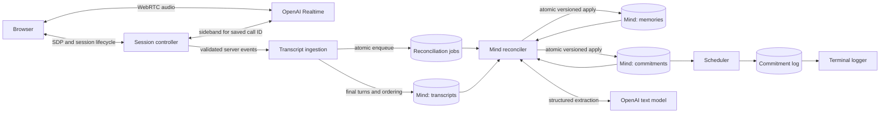

# Openloop MVP architecture

Status: implementation baseline. Date: 2026-10-15.

This specification locks the architecture for the requested MVP. It builds on [app-flow.md](../app-flow.md) and the supplied architecture drawing. Decisions below are application policies unless explicitly attributed to OpenAI. Changes to these decisions require updating this document before implementation.

## 1. Scope and locked decisions

The demonstrable loop is **Listen → Understand → Remember → Anticipate → Act**, where Act means a durable backend commitment log plus a terminal log. Mind is one PostgreSQL database containing three logical domains: transcripts, memories, and commitments. Operational tables in the same database make that loop recoverable.

| Concern | Locked decision |
| --- | --- |
| Deployment | One browser frontend, one long-running backend process, one PostgreSQL database. In-process polling loops, no separate worker service. |
| Implementation baseline | TypeScript, Bun, React, Express, `ws`, Zod, PostgreSQL. Reuse the reference app's transport and validation patterns. Use parameterized SQL through `pg` for explicit transactions and locks, and `@js-temporal/polyfill` for timezone conversion; no ORM or queue dependency. |
| Voice | Browser ↔ OpenAI Realtime over WebRTC; backend ↔ the same call over a sideband WebSocket. |
| Initialization | Backend creates the call through the unified SDP endpoint and obtains its call ID. No ephemeral-token endpoint in this MVP. |
| Transcript authority | Backend sideband is the sole transcript writer. Persist final transcript text and item/order metadata; ignore text deltas for persistence and extraction. |
| Extraction | OpenAI Responses API, text model, strict structured output. No tools or external actions available to the extractor. |
| Extraction cadence | Incremental ordered batches during a call, plus a final drain on close. No extraction from a partially transcribed turn. |
| Extraction evidence | Completed user turns are authoritative. Assistant text is stored for inspection, but is not extraction evidence or model context in this MVP. Ambiguous replies such as “yes, that one” are skipped unless preceding user turns resolve them. |
| Memory representation | `memories` contains semantic and episodic records. `commitments` is the single canonical representation of prospective memory. Do not duplicate a commitment in `memories`. |
| Recall | Mind supports backend/UI reads. No Mind reads, memory tools, or remembered context are injected into Realtime. |
| Scheduling | Only open commitments with a resolved due time are eligible. Log once per schedule version at/after that time. Highest priority first among currently eligible commitments. |
| Concurrency | One live call and one ordered reconciliation stream per user. Database ownership tokens and revision checks fence stale extraction results. |
| Reliability boundary | Durable processing starts when Postgres commits an ingested event. Realtime is not treated as a replayable event log. Interrupted capture is reported as incomplete. |

`app-flow.md` describes future conversational recall, semantic retrieval, user-facing reminders, and memory correction screens. This milestone implements backend read/correction contracts and lexical search, but defers those full screens, embeddings, and conversational recall. It adds backend-only scheduled logging as requested even though the flow labels proactive reminders out of v0. No push/email/SMS, recurring tasks, calendar integration, entity graph, vector database, Redis, broker, workflow engine, or general agent framework.

### Reference implementation findings

- [interview route](../intervue.ai/apps/backend/routes/interview.ts): reuse server-side multipart SDP exchange, `Location` parsing, and association with an application session.
- [Realtime service](../intervue.ai/apps/backend/services/realtime.ts): reuse the sideband URL containing `call_id` and server-only API-key authentication.
- [browser component](../intervue.ai/apps/frontend/src/components/Interview.tsx): reuse microphone tracks, peer connection, remote audio, and cleanup structure.
- [database schema](../intervue.ai/apps/backend/prisma/schema.prisma): demonstrates Postgres persistence, but its arrival-time messages lack the identity, ordering, provenance, and concurrency fields needed here.

Do not copy its separate Deepgram path, browser-submitted transcript chunks, response-before-sideband-ready behavior, or interview-specific Gemini evaluation. No local `echo-er` implementation was found; the inspected `intervue.ai` implementation is the concrete local reference. It is inspiration, not an existing Openloop runtime or a migration source. No existing Openloop tests or package manifest were found outside that reference directory.

## 2. Components and ownership



All boxes except Browser, OpenAI, and Postgres are modules in the same backend. Mind repositories own SQL; other modules call the interfaces below. Transport cannot write memories, ingestion cannot call the LLM, the LLM cannot write SQL, and the scheduler cannot change commitment meaning or completion status. No module needs an implementation from a later layer to run its own tests. Shared DTOs, validators, error types, and transaction invariants belong to layer 1's `contracts` module, including contracts described under later consuming layers. Layer 1 tests its atomic apply operation using supplied validated change sets, without importing an extractor.

## 3. Layer 1 — contracts, PostgreSQL, and Mind

**Prerequisites:** none beyond Bun and PostgreSQL. Create `apps/backend/src/{contracts,mind}`, SQL migrations, and database test fixtures in the future implementation. Do not modify the reference application's database.

### 3.1 Common database rules

The following is the normative relational schema. Column lists are exhaustive except where a common-column rule explicitly applies. `?` means nullable; other columns are `NOT NULL`. IDs are application-generated UUIDs unless identified as provider text IDs. All times are `timestamptz`, stored in UTC. PostgreSQL `now()` is the authority for claims and eligibility. IANA timezone strings are validated at the service boundary. Integer counters start at zero unless stated otherwise.

Use SQL `CHECK` constraints for every listed enum, positive version/counter ranges, and state-dependent nullability. All foreign keys use `ON DELETE RESTRICT`; normal deletion is a domain tombstone, not cascading transcript destruction. Each child carrying `user_id` uses a composite FK `(user_id, parent_id)` to the parent's unique `(user_id, id)`. This also applies to evidence pointing at transcripts, jobs, and entities. Never accept `user_id` from a request body as authority.

All domain writes acquire the user's `mind_state` row lock first. When needed, further locks are acquired in this order: session, job, memories sorted by ID, commitments sorted by ID, log records. Ingestion uses the same order. Transactions remain short; no network or LLM request runs inside a transaction.

#### `users`

| Column | Type / meaning |
| --- | --- |
| `id` | uuid PK |
| `timezone` | text, validated IANA zone |
| `created_at` | timestamptz |

For the local demo, seed one user and map a server-controlled local session to it; bind to localhost. Remote/multi-user exposure requires an authenticated principal adapter first. Repository contracts are user-scoped from day one; no authentication provider dependency is required for the local demonstration.

#### `mind_state`

| Column | Type / meaning |
| --- | --- |
| `user_id` | uuid PK, FK users |
| `revision` | bigint, increments on each successful extraction apply or manual domain mutation |
| `next_session_seq` | bigint, starts at 1; allocated under this row lock |
| `updated_at` | timestamptz |

The revision covers semantic data, not receipt of new transcript text or scheduler logging. Even an extraction with zero changes advances revision when its cursor is committed, so a job has one unambiguous applied result.

#### `voice_sessions`

| Column | Type / meaning |
| --- | --- |
| `id`, `user_id` | uuid PK; user FK |
| `session_seq` | bigint, monotonic per user |
| `start_request_id` | uuid, browser-generated request idempotency key |
| `offer_hash` | text, SHA-256 of offered SDP; do not store SDP |
| `call_id`, `realtime_session_id` | text?, provider identifiers; distinct from this row's ID |
| `state` | `initializing`, `connecting`, `active`, `draining`, `closed`, `incomplete`, `failed` |
| `timezone` | text, immutable copy at session creation |
| `created_at`, `updated_at` | timestamptz |
| `activated_at`, `closed_at`, `close_requested_at` | timestamptz? |
| `last_client_heartbeat_at`, `last_sideband_event_at` | timestamptz? |
| `capture_epoch` | bigint, initially 1; increment when capture is fenced/closed |
| `ordered_through` | integer, last safely numbered conversation item; initially 0 |
| `sealed_through` | integer, last item covered by a durable extraction batch; initially 0 |
| `applied_through` | integer, last successfully applied batch boundary; initially 0 |
| `close_reason`, `error_code` | text?, bounded application codes, no raw exception payload |

Constraints: unique `(user_id, id)`, `(user_id, session_seq)`, `(user_id, start_request_id)`, plus a unique index on `call_id WHERE call_id IS NOT NULL` (initializing/failed rows may have no call ID). Partial unique index on `user_id` where state is initializing/connecting/active/draining. Require `0 <= applied_through <= sealed_through <= ordered_through`. Terminal states have `closed_at`. This prevents simultaneous browser tabs from creating overlapping user timelines.

#### `transcript_items`

An item is an ordering node; it is not a transcript delta. Placeholder rows may exist before an ordering or final-text event arrives.

| Column | Type / meaning |
| --- | --- |
| `id`, `user_id`, `session_id` | uuid PK; user and session FKs |
| `provider_item_id` | text, Realtime item ID |
| `predecessor_known` | boolean; distinguishes unknown predecessor from confirmed root |
| `previous_item_id` | text?, provider predecessor ID; null means root only when known |
| `ordinal` | integer?, assigned from the verified predecessor chain, starts at 1 |
| `role` | `unknown`, `user`, `assistant`, `other` |
| `item_type` | text?, provider type; tools/system items are unsupported but retain structural identity |
| `state` | `pending`, `complete`, `failed`, `interrupted`, `excluded` |
| `expected_parts` | integer?, determined from the item's content metadata |
| `provider_response_id` | text?, for assistant lifecycle correlation |
| `first_seen_at`, `updated_at` | timestamptz |
| `committed_at` | timestamptz?, first backend observation of input_audio_buffer.committed; immutable once recorded |
| `time_anchor_at` | timestamptz?, frozen on sealing from speech_stopped_at, otherwise committed_at; null when neither was observed |
| `speech_started_at`, `speech_stopped_at` | timestamptz?, backend observation times |
| `audio_start_ms`, `audio_end_ms` | integer?, provider audio positions, not ordering keys |
| `terminal_at` | timestamptz? |
| `error_code` | text? |

Constraints/indexes: unique `(user_id, id)`, `(session_id, provider_item_id)` and `(session_id, ordinal)` for non-null ordinals; index `(session_id, previous_item_id)`. No FK on the predecessor string: its event may not have arrived. The assembler validates same-session resolution, roots, cycles, and ambiguous branches. Preserve ordering nodes for assistant items even when their speech is interrupted.

#### `transcript_parts`

| Column | Type / meaning |
| --- | --- |
| `id`, `user_id`, `item_id` | uuid PK; user and transcript-item FKs |
| `content_index` | integer >= 0 |
| `kind` | `user_audio`, `assistant_audio`, `assistant_text` |
| `final_text` | text?, only from a final event |
| `state` | `pending`, `complete`, `failed`, `interrupted`, `excluded` |
| `final_event_id` | text?, provider event ID |
| `text_hash` | text?, SHA-256 of final text |
| `completed_at` | timestamptz? |
| `error_code` | text? |

Unique `(user_id, id)`, `(item_id, content_index)`. Complete parts require final text, hash, event ID, and completion time; `''` is a valid completed silence/no-text result. Empty text does not create memories. A non-empty incomplete transcript is never stored as final text. Interrupted/excluded parts may retain previously received final text for inspection, but are not extraction input. Do not persist audio or partial transcript deltas.

#### `reconciliation_jobs`

| Column | Type / meaning |
| --- | --- |
| `id`, `user_id`, `session_id` | uuid PK; user and session FKs |
| `from_ordinal`, `through_ordinal` | integer, inclusive immutable range |
| `input_hash` | text, hash of canonical ordered user-part IDs, text hashes, frozen time anchors, and session timezone through this boundary |
| `state` | `pending`, `running`, `retry_wait`, `succeeded`, `blocked`, `skipped` |
| `attempts` | integer, starts at 0 |
| `available_at` | timestamptz |
| `claim_token` | uuid?, regenerated on each claim |
| `lease_until` | timestamptz? |
| `base_mind_revision` | bigint?, set at each claim |
| `model`, `prompt_version`, `schema_version` | text; set from pinned deployment configuration |
| `last_error_code` | text? |
| `resolution_note` | text?, maximum 500 characters; operator reason for explicit retry/skip |
| `created_at`, `updated_at`, `finished_at` | timestamptz; finished_at nullable |

Constraints: `1 <= from_ordinal <= through_ordinal`, unique `(user_id, id)` and `(session_id, from_ordinal)`. Partial unique index on `user_id` where state=`running`. Index `(state, available_at)` and `(user_id, session_id, from_ordinal)`. Running requires token, lease, and base revision; other states clear token/lease. Success/skipped are terminal. Ranges never overlap: enforce in the locked session transaction that the next range starts at `sealed_through + 1`.

The ordered transcript rows are the immutable job input; no second full transcript copy is stored in the job. Every retry rebuilds the current Mind snapshot. Model configuration remains fixed for ordinary retries.

#### `memories`

| Column | Type / meaning |
| --- | --- |
| `id`, `user_id` | uuid PK; user FK |
| `kind` | `semantic`, `episodic` |
| `subject`, `predicate` | text; normalized grouping fields, e.g. `ananya`, `movie_preference` |
| `content` | text, human-readable fact/event |
| `occurred_at` | timestamptz?, episodic time when explicitly resolvable |
| `time_text` | text?, original temporal phrase |
| `state` | `active`, `deleted` |
| `version` | bigint >= 1 |
| `manual_override` | boolean, initially false |
| `created_at`, `updated_at` | timestamptz |

Unique `(user_id, id)`. Index `(user_id, state, kind, updated_at)` and `(user_id, subject, predicate)`. No uniqueness on subject/predicate: one person can have multiple preferences/events. Semantic changes update an existing ID when clearly the same fact; episodic events remain separate. Ambiguous identity is not merged. Manual correction/deletion sets `manual_override=true`; extraction cannot update/recreate that same fact from already processed evidence. A later explicit UI release can clear this flag. Deleted rows remain in the extraction snapshot as suppression records.

#### `commitments`

| Column | Type / meaning |
| --- | --- |
| `id`, `user_id` | uuid PK; user FK |
| `title` | text, actionable description |
| `subject` | text?, person/topic as spoken, no entity service |
| `status` | `open`, `completed`, `dismissed` |
| `priority` | smallint: 1 high, 2 normal (default), 3 low |
| `due_at` | timestamptz?, resolved eligibility instant |
| `due_timezone` | text?, IANA zone used to resolve the due time |
| `due_text` | text?, original temporal phrase |
| `due_precision` | `instant`, `date`, `unresolved`, `none` |
| `version` | bigint >= 1, changes on every semantic edit |
| `schedule_version` | bigint >= 1, changes only under the rules in layer 5 |
| `manual_override` | boolean, initially false |
| `created_at`, `updated_at` | timestamptz |
| `completed_at`, `dismissed_at` | timestamptz? |

Unique `(user_id, id)`. Due index `(due_at, priority, id)` where status=`open` and due_at is not null. Require due_at and due_timezone for instant/date, and null due_at for unresolved/none. Completed/dismissed timestamps must match status. Overdue is a query result, not a status. Logging does not mean task completion.

#### `mind_changes` and `change_sources`

These small audit/evidence tables preserve history without a separate event-sourcing framework.

`mind_changes`: `id uuid PK`, `user_id uuid FK`, `job_id uuid? FK`, `memory_id uuid? FK`, `commitment_id uuid? FK`, `entity_version bigint`, `operation text` (`create`, `update`, `delete`, `complete`, `dismiss`, `reopen`, `release_override`), `actor text` (`reconciler`, `user`), `after_state jsonb`, `created_at timestamptz`.

Require exactly one target FK; actor=reconciler requires a job ID, actor=user requires none. `after_state` is a runtime-validated full domain record at that version, not arbitrary model JSON. Standard unique constraints on `(memory_id, entity_version)` and `(commitment_id, entity_version)` allow the unused null target; unique `(user_id, id)`.

`change_sources`: `user_id uuid FK`, `change_id uuid FK`, `transcript_part_id uuid FK`, `evidence_text text`; PK `(change_id, transcript_part_id)`. Evidence must be a verbatim substring of that completed user part. Every reconciler change requires at least one source, including at least one part from the job's new range. Enforce this invariant in the transactional repository and integration tests. Manual changes have an authenticated actor and may have no transcript source. Historical evidence is retained when a record is revised, completed, or dismissed.

Do not use a polymorphic unvalidated `entity_id` or array of source strings in place of these FKs. Queries can trace a commitment log → commitment/version → change → job → ordered transcript parts/session.

#### `commitment_logs`

| Column | Type / meaning |
| --- | --- |
| `id`, `user_id`, `commitment_id` | uuid PK; user and commitment FKs |
| `schedule_version`, `commitment_version` | bigint, versions at eligibility decision |
| `due_at`, `eligible_at` | timestamptz; eligible_at is the scheduler transaction's clock |
| `priority` | smallint 1–3, snapshot |
| `title_snapshot` | text, durable private log content |
| `batch_id` | uuid, identifies one scheduler tick's ordered eligible set |
| `batch_position` | integer >= 1 |
| `emitted_at` | timestamptz?, terminal sink acknowledgment |
| `emit_attempts` | integer, initially 0 |
| `emit_available_at` | timestamptz |
| `last_error_code` | text? |

Unique `(commitment_id, schedule_version)` and `(batch_id, batch_position)`; index `(emit_available_at)` where emitted_at is null. FK `(commitment_id, commitment_version)` references `mind_changes(commitment_id, entity_version)`, preserving the exact logged revision as well as the user-scoped commitment FK. This is both the durable backend log and a tiny outbox for the terminal sink. No additional notification table/service is needed.

### 3.2 Mind interfaces

Each operation receives an authenticated `UserScope`, accepts parsed/validated DTOs, and returns typed errors. The following names and semantics are the public module boundary, not HTTP route requirements for internal workers.

```ts
type UserScope = { userId: string };
type Counter = string; // validated non-negative decimal bigint, positive for versions
type Versioned = { expectedVersion: Counter };
type Page = { limit: number; cursor: string | null }; // limit 1..100
type DomainError =
  | "not_found" | "invalid_input" | "version_conflict"
  | "capture_closed" | "ordering_gap" | "stale_claim"
  | "stale_snapshot" | "dependency_blocked";

interface MindReader {
  getSnapshot(scope: UserScope): Promise<MindSnapshot>;
  listMemories(scope: UserScope, query: MemoryQuery & Page): Promise<MemoryPage>;
  listCommitments(scope: UserScope, query: CommitmentQuery & Page): Promise<CommitmentPage>;
  getTranscript(scope: UserScope, sessionId: string, page: Page): Promise<TranscriptPage>;
  getProvenance(scope: UserScope, entity: EntityRef): Promise<ChangeWithSources[]>;
}
interface MindWriter {
  editMemory(scope: UserScope, id: string, patch: MemoryEdit & Versioned): Promise<Memory>;
  deleteMemory(scope: UserScope, id: string, guard: Versioned): Promise<Memory>;
  editCommitment(scope: UserScope, id: string, patch: CommitmentEdit & Versioned): Promise<Commitment>;
  applyExtraction(claim: JobClaim, changes: ValidatedChangeSet): Promise<ApplyResult>;
}
```

`MindSnapshot` contains revision plus all memory records (including tombstones/overrides) and commitments (including closed ones) for this demo user. `MemoryQuery` allows kind/subject/text; `CommitmentQuery` allows status/due-before/priority; search is parameterized lexical `ILIKE`, without promising semantic retrieval. Records use the schema above; timestamps are ISO-8601 strings, bigint counters use `Counter` (SQL adapters must likewise avoid unsafe JS-number coercion). MemoryEdit permits content/subject/predicate/occurred_at/time_text and explicit release of manual override. CommitmentEdit permits title/subject/priority/due fields/status and override release. Kind and ownership cannot be edited. Every edit must include at least one supported field; null is explicit, omitted means unchanged. Mutation errors map to HTTP 400/404/409; infrastructure failures map to 503 and never look like an empty result.

Pages use stable keyset order: memories `(updated_at,id)`, commitments `(priority,due_at NULLS LAST,id)`, transcript `(ordinal,content_index)` with unplaced items returned separately as gaps. Every read is user-scoped. GET requests never start reconciliation. Manual writes check expected version, append a change record, increment Mind revision, and set manual override in one transaction. API updates cannot silently erase evidence. Domain validation rejects unsupported fields rather than forwarding arbitrary JSON into SQL.

HTTP adapters expose `GET /api/mind/memories`, `GET /api/commitments`, `GET /api/sessions/:id/transcript`, and `GET /api/mind/:entityType/:id/provenance`; `PATCH /api/mind/memories/:id`, `DELETE /api/mind/memories/:id`, and `PATCH /api/commitments/:id` carry the version guard. Successful edits return the full versioned record; delete returns its tombstone. There is no public extraction-apply endpoint. General transcript erasure and raw-transcript editing are outside this milestone; do not imply that deleting a memory deletes its historical transcript evidence.

**Acceptance:** run migrations on an empty database; validate FK/uniqueness/check constraints, user isolation, rollback on missing evidence, optimistic edit conflict, and provenance reads. Seed all three domains and demonstrate read/write behavior with no OpenAI, browser, or worker running.

## 4. Layer 2 — transcript ingestion and complete batch formation

**Prerequisites:** layer 1 only. Implement `transcripts/{normalize,ingest,assemble,batch}.ts`. Input is a fake or real event source; no transport or LLM is needed to test this layer.

### 4.1 Ingestion contract and event mapping

```ts
interface TranscriptIngestor {
  ingest(sessionId: string, epoch: string, event: NormalizedEvent): Promise<IngestResult>;
  sealReadyPrefix(scope: UserScope, sessionId: string, cause: "timer" | "close"): Promise<BatchResult>;
  finishCapture(scope: UserScope, sessionId: string, reason: CloseReason): Promise<CaptureSummary>;
}
```

`NormalizedEvent` is a Zod-validated discriminated union for item-order metadata, speech boundaries, user-part completion/failure, assistant terminal output, and truncation. All variants carry the original server event ID, item ID where applicable, and backend receipt time. Ordering carries `predecessorKnown`, nullable `previousItemId`, role/type, and nullable expected part count; part results carry content index and either final text or a bounded error code; speech carries start/stop and audio offset; assistant terminal output carries response ID/status and per-item final content; truncation carries content index/audio end. Supported user items contain audio parts indexed contiguously from 0; other user content types are rejected in this voice-only MVP. `IngestResult` is `stored`, `duplicate`, `ignored`, or `capture_closed`; conflicts return a typed integrity failure and close capture. Associate the event with the sideband's saved session, never an event-supplied user ID.

| Provider event | Application behavior |
| --- | --- |
| `conversation.item.added` / `conversation.item.done` | Upsert item identity, role, content indexes, and predecessor metadata. Item completion alone is not user transcription completion. |
| `input_audio_buffer.committed` | Record the user item and predecessor link. Reconcile with item metadata if it arrives later. |
| `input_audio_buffer.speech_started` / `.speech_stopped` | Track pending speech, approximate observation time, and provider audio offsets. No extraction. |
| `conversation.item.input_audio_transcription.completed` | Persist final text for `(session,item_id,content_index)`; finish a user item only after every expected part is complete. |
| `conversation.item.input_audio_transcription.failed` | Mark the part/item failed; block extraction through this item. |
| `response.done` | Inspect response status and output item IDs; persist assistant final content only for completed output. Mark cancelled/failed/incomplete outputs interrupted. |
| `conversation.item.truncated` | Retain ordering identity, mark assistant item/parts interrupted. Do not try to infer a heard-text prefix from audio milliseconds. |
| Text/audio delta events | Discard from durable ingestion and extraction. Browser may use them for ephemeral captions. |
| Unknown relevant item type, deletion, conflicting final text/order | Record an error code and stop capture as incomplete. No silent reordering or overwriting of sealed input. |

The [Realtime server-event reference](https://developers.openai.com/api/reference/resources/realtime/server-events) defines item identities, predecessor fields, asynchronous user transcription, and terminal response statuses. The input transcript is a separate ASR interpretation, not guaranteed to match exactly what the speech model understood.

Process messages through one serial async ingestion queue per sideband, including awaited DB writes; do not use independent untracked async WebSocket callbacks. Completion events can still be out of conversation order. Queue capacity is 1,000 normalized events; overflow or a failed DB write stops capture and exposes incompleteness, rather than dropping events. Ignored deltas never enter this queue.

Idempotency uses domain keys, not a giant raw-event ledger: repeated metadata is a no-op, and repeated final content must match the saved hash. Completion before item metadata creates a placeholder. A duplicate final event with different text is an integrity error. Persist only required metadata and final text; never log raw provider payloads.

### 4.2 Ordering and completeness

OpenAI explicitly warns that completion events for separate turns can arrive out of order; correlate with item IDs. See [Realtime transcription](https://developers.openai.com/api/docs/guides/realtime-transcription#handle-transcript-events). Item IDs are opaque, not sortable sequence numbers.

1. Construct the session's conversation chain from confirmed predecessor links. A null predecessor with `predecessor_known=true` is the root; an absent predecessor field is unknown, not root.
2. Include assistant/other structural nodes when walking this chain. A user item's predecessor may be an assistant item. Do not build a user-only predecessor graph.
3. Assign contiguous ordinals only to the chain connected to the confirmed root. Never sort by arrival, completion time, UUID, or transcript text. An unresolved predecessor stops the connected prefix. Multiple roots, branches, cycles, or a late insertion before a sealed boundary are integrity failures in this append-only MVP.
4. Extraction can advance only over nodes with known role and ordering metadata. Every user item crossed must have its expected content indexes known and all parts successfully completed. Assistant nodes require ordering identity but do not block on assistant text: that text is not extraction input. Unsupported `other` items stop the prefix.
5. A timer every 2 seconds seals the largest eligible unsealed prefix, ending at a completed user item. It may include up to 20 new user turns, and never splits a turn. This is a batching cadence, not proof of completeness. Seal immediately on clean close.
6. In a single transaction, lock user/session, verify that prefix, freeze each new user item's time_anchor_at, insert a job and advance `sealed_through`. If there are no new user turns, create no job. A future batch may cross trailing assistant nodes. Maintain the invariant that no two jobs contain the same new user part. Late speech-boundary metadata may improve inspection but cannot change a sealed item's anchor or job hash.

Each extraction receives all completed user turns from the session root through its boundary, clearly separating the new range from earlier context. This makes pronouns and corrections across user turns interpretable without re-extracting old turns. It does not depend on assistant wording. Every proposed mutation must cite new user evidence; old context alone cannot create a duplicate mutation.

Example: chain `U1 → A1 → U2`, but U2 transcription completes first. Store U2, enqueue nothing through U2. When U1 completes and chain metadata is present, seal the prefix in U1/U2 order. A `response.done` event for A1 does not prove that U1 has transcribed.

### 4.3 Gaps, close, and late data

There is no assumed provider-wide “all transcripts complete” watermark. Completeness means the verified prefix under the uninterrupted-capture contract above.

- A known user transcription/order gap persisting for 30 seconds while active ends capture as incomplete. Complete earlier prefixes may be processed; the gap and everything after it are excluded from new extraction. The UI reports the missing capture and asks the user to repeat the affected statement in a new call.
- On graceful close, disable microphone input but keep WebRTC/data channel and sideband alive for up to 10 seconds. Wait for detected speech to receive its committed item, for all known committed user parts to finish, and for the ingestion queue to drain. Allow at least 1 second of no new relevant events after microphone disable before considering this drain complete. Quiet time is only a practical drain heuristic, never proof against network loss.
- If a pending utterance/part/link remains at the deadline, or the sideband/browser disconnects unexpectedly, mark the session incomplete. Seal only the already safe prefix. Mark known unsealed user suffix items/parts excluded, and fence capture by incrementing its epoch. Do not advance a cursor across missing text. Finalization loops over the entire safe prefix in batches of at most 20 turns, rather than excluding complete turns merely because the first batch filled. Under the user/session lock, enqueue all remaining safe batches before the terminal session transition permits a new session; this preserves cross-session FIFO.
- Closed/incomplete sessions are immutable extraction boundaries. Events from an old capture epoch are rejected. They are not retroactively inserted behind newer jobs or newer sessions. The browser cannot submit replacement transcripts. Recovery is an explicit new spoken turn, not stale replay.
- Backend restart treats unfinished voice sessions as incomplete and seals only durable safe prefixes. No sideband reconnect is considered lossless, and no provider history replay is assumed. Already committed jobs survive normally.

The client must stop its mic after an incomplete/error status or missed backend heartbeat; the backend also closes/hangs up the call when possible. Audio sent during a network failure can be lost. This limitation is visible and is not repaired by inventing transcript text.

**Acceptance:** replay a synthetic stream with U2 before U1, final text before metadata, interleaved assistant nodes, duplicate completions, missing predecessor, unknown versus null root, failed transcription, empty final text, multi-part input, and stale-epoch events. Verify exact job ranges and hashes. Crash between item persistence and batching, restart the periodic scan, and show that a missing job is created exactly once. Test enqueue+cursor rollback atomically. No real OpenAI calls are required.

## 5. Layer 3 — session initialization and transport

**Prerequisites:** layers 1–2. Implement `sessions/{routes,controller,sideband}.ts` and the browser voice hook. Reconciliation and scheduling are not prerequisites: this layer is complete when a real conversation produces correct durable transcripts.

### 5.1 The call binding handshake

The supplied drawing's token exchange is replaced with the unified server-created call flow already used by `intervue.ai`. This is a deliberate simplification: the backend owns the authenticated association between app session, user, and provider call ID. Browser audio still goes directly to OpenAI. The [official WebRTC guide](https://developers.openai.com/api/docs/guides/voice-webrtc?api=realtime) documents the unified SDP exchange, and [server-side controls](https://developers.openai.com/api/docs/guides/realtime-server-controls#with-webrtc) documents attaching with the returned call ID.

1. Browser obtains mic permission, creates `RTCPeerConnection` and `oai-events` data channel, registers handlers, and adds a **disabled** microphone track. It creates an SDP offer and a fresh `startRequestId` for this peer connection.
2. `POST /api/sessions` accepts `{startRequestId, sdpOffer, timezone}` (maximum 64 KiB). Authenticate/map the demo user, validate the timezone, and reserve a session/sequence under the user lock. A second live session returns `409 active_session_exists`.
3. Backend sends multipart `sdp` and `session` to `POST https://api.openai.com/v1/realtime/calls`, authenticated using its API key. Configure input transcription explicitly, server VAD, audio output, fixed conversational instructions, and no tools. Do not request a greeting before readiness.
4. Check the upstream HTTP status and SDP content, parse the documented `Location` path, and save its non-empty call ID on the reserved row. Missing/invalid location is a setup failure. Never convert `undefined` into a call ID or accept a caller-supplied call ID.
5. Register sideband handlers **before** waiting for its open event; attach to `wss://api.openai.com/v1/realtime?call_id=<encoded saved call ID>` with the server API key. Save the provider session ID from session events. `call_id`, provider `session.id`, and Openloop session UUID are different identifiers.
6. Return `{sessionId, sdpAnswer, state:"connecting"}` so the browser can complete WebRTC negotiation while the sideband attaches. Keep its microphone disabled. This avoids assuming sideband initialization can finish before peer negotiation.
7. Backend verifies sideband open, database ingestion readiness, and a `session.updated` acknowledgment of its explicit transcription/VAD configuration. `GET /api/sessions/:id` exposes `captureReady=true` only then. Browser polls every 500 ms during setup and enables the mic only when WebRTC/data channel are also connected. It sends `POST /api/sessions/:id/activate`; the backend verifies readiness and transitions to active before the browser enables the track.
8. Setup must finish within 15 seconds overall; individual upstream requests have abort timeouts. Failure closes local resources, attempts provider hangup using the saved call ID, marks failed, and returns a structured error. A lost response never triggers an automatic second upstream call creation.

Start idempotency: look up the user/request ID before checking for a conflicting active session. The same ID with a different offer hash returns 409. An in-process duplicate awaits the same setup promise and may receive its cached SDP answer for 30 seconds. After process loss or cache expiry, return 409 `restart_required` and close any surviving reserved call; the browser creates a new peer/request only after the prior session is terminal. Do not persist sensitive SDP or retry non-idempotent call creation blindly. An upstream call created just before an unobservable connection failure may remain orphaned until provider expiry; the browser remains muted and no transcript completeness claim is made.

### 5.2 Lifecycle HTTP contract

| Endpoint | Behavior |
| --- | --- |
| `POST /api/sessions` | Validated setup above; 201 ready-to-negotiate, 400 validation, 409 conflict, 502 upstream failure, 504 setup timeout. |
| `GET /api/sessions/:id` | State, captureReady, gap/error code, sealed/applied cursors, reconciliation backlog. No API key, provider payload, or transcript body. |
| `POST /api/sessions/:id/activate` | Idempotent activation after sideband readiness. |
| `POST /api/sessions/:id/heartbeat` | Every 5 seconds while active/draining; state in response. Missing for 15 seconds triggers incomplete shutdown. |
| `POST /api/sessions/:id/close` | Idempotent transition to draining; returns 202 plus current state; browser polls until terminal before releasing peer. |

Mic denial fails before backend creation. Stop/unmount cleans tracks, listeners, timers, audio playback, and peer connection; an abrupt unmount may yield incomplete finalization. A maximum 15-minute local session cap bounds demo input/context growth; notify and drain before starting a new session. Unexpected sideband close stops capture immediately; do not reconnect and claim continuous recording. Provider shutdown errors are recorded separately from transcript completeness.

This design stays on **Realtime** `/v1/realtime/*` and its item/completion events. Documentation may also show GPT-Live examples; do not mix `/v1/live/*` endpoints or delta-only transcript semantics into this implementation.

**Acceptance:** mocked upstream proves exact saved call-ID binding, no browser-selected call attachment, mic gating, error cleanup, duplicate start handling, and timeout behavior. A manual real-call smoke test must confirm session configuration acknowledgments and actual event shapes before this layer is accepted. Speak two turns; confirm final text, IDs, predecessor chain, no partial rows, and visible incomplete state on sideband disconnect. No reconciler required.

## 6. Layer 4 — Mind reconciler

**Prerequisites:** layers 1–2; layer 3 is optional for development. Implement `reconciliation/{worker,extractor,validate,apply}.ts`. Seed transcripts/jobs for independent tests.

### 6.1 Trigger, claims, and ordering

The durable job row is the trigger. A single backend loop polls every 1 second; ingestion may wake it early as an optimization. Startup immediately scans pending work and expired leases. The poll is the recovery mechanism; an in-memory wakeup is not the source of truth.

For each user, only the earliest unfinished job ordered by `(session_seq, from_ordinal)` can run. Retry-wait and blocked earlier jobs prevent later jobs for that user from running. New calls may still be captured, but their jobs queue behind the failure. A session's incomplete excluded suffix creates no phantom pending job.

Claim transaction:

1. Lock `mind_state`, then the relevant session/job; recheck that it is the earliest eligible job and that no running claim exists for this user.
2. An expired running claim becomes retry-wait (or blocked at the attempt limit). A new claim receives a new UUID token, increments attempts, and gets a 90-second lease. Never reuse a dead worker's token.
3. Set `base_mind_revision`, read the complete Mind snapshot and immutable ordered transcript prefix consistently under that lock, and verify input hash. Commit before calling OpenAI.

Use a 45-second text-model request timeout, no hidden HTTP-library retries, and a 4,000-output-token limit. One extraction runs at a time in the MVP process. A lease is still required to fence a slow/crashed process against an accidental second process or later recovery.

### 6.2 Extractor contract

```ts
interface TextExtractor {
  extract(input: ExtractionInput, signal: AbortSignal): Promise<ExtractionOutcome>;
}
type ExtractionOutcome =
  | { kind: "success"; proposals: ProposedChange[] }
  | { kind: "refusal" }
  | { kind: "incomplete" }
  | { kind: "invalid_output" };
```

`ExtractionInput` contains job/model/prompt/schema versions, session timezone and start time, new ordinal range, ordered completed user parts with IDs and frozen time anchors, earlier user context, and Mind snapshot with entity IDs/versions/overrides. Keep system instructions separate from transcript data; spoken requests to ignore instructions or manipulate priorities are data for classification, not execution privileges.

Use `POST /v1/responses`, `store:false`, and `text.format` with strict JSON Schema. Schema conformance does not establish semantic truth; validate again before application. OpenAI documents structured schemas and refusal handling in [Structured Outputs](https://developers.openai.com/api/docs/guides/structured-outputs).

The response is `{schema_version:"1", changes:[...]}`. Every object disallows extra properties. Maximum 50 changes per job. Each change has:

| Field | Contract |
| --- | --- |
| `entity` | `memory` or `commitment` |
| `action` | `create`, `update`, `delete`, `complete`, `dismiss`, `reopen`; entity-specific validity enforced |
| `target_id`, `expected_version` | Existing ID/version for mutations, both null for create |
| `value` | Full proposed memory or commitment semantic fields from layer 1; no IDs, version counters, timestamps, audit fields, or schedule version generated by the LLM |
| `sources` | Non-empty list of `{part_id, evidence_text}` with unique part IDs; at least one source from new range |

For memory values: kind/subject/predicate/content/occurred_at/time_text. For commitment values: title/subject/status/priority/due_text/due_precision plus nullable proposed local date, local time, timezone, explicit offset, and relative-duration seconds. Exactly one temporal representation is allowed when resolved; the server validates it against precision and evidence. For `create`, status can be open/completed/dismissed when the new range supplies the respective evidence; thus a promise already completed in the same batch need never become schedulable. For existing records, update preserves status, complete sets completed, dismiss sets dismissed, and reopen sets open. Server code resolves the UTC time and sets all bookkeeping fields. Existing terminal commitments may reopen only from an explicit new user intention. An unresolved pronoun, doubtful task match, or unsupported temporal interpretation produces no destructive update.

Extraction rules:

- Facts/preferences → semantic; occurred events → episodic; explicit user promises/tasks → commitments. Assistant suggestions alone cannot create any of these.
- Reuse an existing entity ID for clear repeats, corrections, rescheduling, completion, or dismissal. Do not create another commitment simply because it is mentioned twice. For the same target within a batch, collapse to the final supported state in conversational order; e.g. promise followed by completion becomes completed with both sources.
- Priority 1 requires explicit urgency/importance, priority 3 explicit low importance, otherwise 2. Priority is not inferred just because the due time is close.
- Skip entities with manual override. Include their suppression state in the prompt; semantic suppression is tested with fixtures but not claimed as a perfect natural-language identity resolver.
- Compare existing content and new proposals before write; identical repeats are no-ops. No-op batches still succeed and advance the cursor. Do not invent memories to make a non-empty response.
- Within one application, validate the entire change set first, apply memory changes, then commitment changes sorted `(priority, due_at NULLS LAST, source ordinal, target ID)`. SQL row insertion order is not a read/log ordering guarantee; readers/scheduler explicitly sort.

Input bounds: at most 64 KiB UTF-8 of user transcript context and 128 KiB of serialized Mind snapshot per request, plus fixed prompt/schema. Select a configured model with sufficient context and test these limits in layer 4. If either bound or output limit is exceeded, block with `context_limit`/`incomplete_output`; do not silently truncate evidence or existing entities. This is an intentional small-demo boundary, not an excuse to introduce retrieval infrastructure.

### 6.3 Atomic application and stale-result fencing

`applyExtraction` opens a transaction and locks user/session/job in the standard order. It must verify all of the following before any write:

1. Job is running, claim token matches, lease has not expired, and it remains the earliest unfinished job for the user.
2. Current Mind revision equals `base_mind_revision`.
3. Session's applied cursor equals `from_ordinal - 1` (or the end of an explicitly skipped prior range); transcript hash and completed source identities match the immutable claimed prefix.
4. Every existing target is owned by this user, present in the snapshot, and still at expected version with no manual override. Every evidence reference belongs to this user/session, is completed user text, and matches the quoted substring. No source lies beyond the job boundary.
5. All semantic, priority, date, action, and evidence constraints pass; there is at most one final mutation per target.

Then atomically write entities, increment entity versions, append changes/evidence, increment Mind revision once, advance the applied cursor, and mark the job succeeded. Clear its claim fields and set finished_at. If any step fails, roll everything back. The scheduler can observe either the whole new commitment set or none of it.

On revision/version conflict, discard the extracted proposals and requeue the same input range with a fresh Mind snapshot; never retry the old patch blindly. Manual edits can therefore proceed during model latency. A cancelled/expired worker's late success is a `stale_claim` no-op; it cannot change the replacement job's status either. New transcript tail arrival alone does not invalidate a claim because sealed user text is immutable.

Example: A claims revision 12 and stalls. Its lease expires; B reclaims with a new token and applies revision 13. A returns later and is rejected by token/revision checks. The same mechanism handles two processes, even though the supported deployment runs one.

### 6.4 Failure policy

| Failure | Policy |
| --- | --- |
| Network/timeout, HTTP 429, HTTP 5xx | Retry same job, maximum 3 total attempts; delays 5 s then 30 s, honoring a longer bounded Retry-After up to 5 minutes. |
| Invalid structured/domain output or incomplete output | One more attempt with the same evidence and explicit validation feedback; then blocked (also subject to total-attempt limit). |
| Refusal; unsupported context size; HTTP 400/401/403 configuration error | Block immediately with a safe code; do not retry on a rapid loop. |
| Snapshot/version conflict | Discard result; requeue with fresh snapshot after 1 s, within total-attempt limit. |
| Process crash/expired lease | Reclaim under the token rules; attempts already consumed count toward limit. |
| DB failure before commit | No applied changes. Retry/recover from durable job state; DB loss during capture separately makes the voice session incomplete. |
| Commit acknowledgment lost | Reload job by ID. Succeeded means do not reapply; otherwise normal fenced recovery. |

Blocked jobs remain visible with their ranges/error/attempt counts and hold later jobs for that user. A local operator command can retry a blocked job after fixing the cause (reset attempts, persist resolution_note and record the explicit retry in structured operational logs), or explicitly skip it with a persisted operator reason. Skipping advances the applied cursor without semantic changes, increments Mind revision, marks skipped, and retains the source rows; show that extraction was skipped. Never auto-skip. Do not automatically reprocess a succeeded/skipped older range after newer work; recovery evidence must be expressed as a new turn/manual edit. No admin UI/service is required.

**Acceptance:** stub the model and clock. Demonstrate extraction across two batches, repeat deduplication, correction, completion, refusal, malformed evidence, cross-user target rejection, retries, dead lease recovery, transaction rollback, and blocked FIFO behavior. Run a two-connection test where A returns after B and prove A changes zero rows. Edit a memory during inference and prove the old patch cannot overwrite it. A small manual OpenAI fixture run validates schema support and semantic quality; it is separate from deterministic tests and cannot prove extraction infallibility.

## 7. Layer 5 — commitment scheduling and backend logging

**Prerequisites:** layer 1 only. Layers 2–4 are optional; use seeded commitments and manual updates. Implement `scheduling/{scheduler,log-emitter}.ts`. The scheduler never calls the LLM.

### 7.1 Time and priority policy

`due_at` is the first instant at which this MVP should log the commitment. There is no inferred lead time, recurrence, snooze, repeated overdue reminder, or silent timezone conversion at display time.

- An explicit timestamp/offset uses that instant. An explicit local date/time uses the spoken zone, otherwise the session's saved zone.
- “In 10 minutes” is resolved relative to the user turn's frozen time_anchor_at (speech-stop observation, otherwise committed_at at sealing). If it is null, leave relative dates/times unresolved. Do not anchor to reconciliation/retry time. This is approximate speech timing, not millisecond-exact scheduling.
- “Tomorrow at 9 AM” uses the turn's local date plus one day and 09:00. An ambiguous AM/PM time such as “at 9” is unresolved unless conversation wording resolves it.
- A date-only “on Friday”/“by Friday” logs at 09:00 on that local date; document this default in the UI. “Before Friday” logs at 09:00 on the preceding local day. The next named weekday includes today if named today; a passed default time is immediately overdue, not silently pushed a week forward.
- A vague “soon”, conditional “when I get home”, or absent date yields null due_at (unresolved or none). The open commitment is visible but unscheduled. Do not guess a time.
- Nonexistent/ambiguous DST local times without an explicit offset are unresolved. A backend date resolver validates the LLM's proposed local calendar values and zone; a UTC timestamp from the LLM is not blindly trusted. Use [@js-temporal/polyfill](https://github.com/js-temporal/temporal-polyfill) with [Temporal disambiguation and calendar arithmetic](https://tc39.es/proposal-temporal/docs/zoneddatetime.html), disambiguation=`reject`, and explicit timezone/offset validation; do not add 24 hours to approximate a local calendar day.
- Explicit past due times and dates that passed during extraction become eligible immediately on persistence. Report lateness; no promise of logging before the commitment was known.

Priority orders **eligible commitments**, not all commitments. At 10:00, high-priority due at 11:00 must not block normal-priority due at 09:59. At a tick where high/normal/low are all due, log high, then normal, then low; within each priority sort by due_at, created_at, ID. No aging or starvation policy is needed for the bounded demo dataset; reconsider only if measurements justify it.

`schedule_version` starts at 1. Increment it when due_at changes (including resolved↔unresolved) or a closed commitment explicitly reopens. Status completion/dismissal removes eligibility immediately; changing only title/priority does not create a fresh schedule or duplicate a prior log. Increment normal entity version for all semantic changes. A due-time change after a log creates a new schedule version eligible at its new time. Clearing a due time cancels further scheduling until resolved again.

### 7.2 Scheduler transaction

```ts
interface CommitmentScheduler {
  tick(): Promise<{ createdLogIds: string[] }>;
}
interface CommitmentLogEmitter {
  flush(): Promise<{ emitted: number; remaining: number }>;
}
```

Run ticks every 1 second using a non-overlapping async loop and also at startup. Use a transaction-scoped advisory lock with a fixed application key to ensure one scheduler tick at a time even if two processes start. Under it, select users with due work, lock their `mind_state` rows in UUID order, then lock commitments. Capture one DB time after locks; recheck eligibility using that instant:

```sql
status = 'open'
AND due_at IS NOT NULL
AND due_at <= :tick_time
AND NOT EXISTS (
  SELECT 1 FROM commitment_logs l
  WHERE l.commitment_id = commitments.id
    AND l.schedule_version = commitments.schedule_version
)
```

Read the bounded demo's full eligible set, sort by `(priority ASC, due_at ASC, created_at ASC, id ASC)`, and insert immutable log snapshots with one batch UUID and ordered positions. The unique schedule key prevents duplicate decisions across retries/restarts. Commit before terminal output. Do not set commitment status to completed or change Mind revision merely for logging.

Race rule: if completion/rescheduling commits before this scheduler transaction's decision, it is respected. If the scheduler commits first, its log remains historical truth even if the user completes the task immediately afterward. An unprocessed spoken completion cannot suppress a log yet; UI status must distinguish “captured/processing” from “saved”. There is no cross-network guarantee that last-moment speech beats a due-time tick.

### 7.3 Terminal emission and delivery semantics

`commitment_logs` is the authoritative exactly-once decision per `(commitment_id,schedule_version)`. Terminal output is **at least once**, because stdout and Postgres cannot be atomically committed together.

One emitter holds a dedicated PostgreSQL session advisory lock while flushing, avoiding concurrent emitters without another queue table. Read un-emitted rows ordered by `(eligible_at,batch_id,batch_position)`, emit one at a time through an injected structured logger, then set emitted_at. Include `event:"commitment_due"`, stable log ID, commitment ID/version, schedule version, priority, due_at, and lateness milliseconds. Default terminal output omits title/private text; an explicit local-demo flag may include title_snapshot. The durable log retains the title for authorized inspection.

If the sink fails, increment emit_attempts, save an error code, and retry after 5 seconds (capped exponential backoff at 60 seconds). Preserve emission order; a failed earlier row holds subsequent rows. A crash after output but before emitted_at may repeat the same log ID. Tests and consumers deduplicate by that ID; never claim exactly-once terminal lines. A DB outage pauses scheduling; startup logs overdue rows once when connectivity returns.

Healthy idle-backend target: already-persisted commitments produce a durable log within 2 seconds of due time, plus terminal sink latency. This is a demo acceptance target, not a hard real-time SLA. LLM backlog, capture gaps, backend downtime, and output failures can make logs late and must be visible.

**Acceptance:** fake clock plus real DB: never log early; high-first ordering within the same eligible set; future high priority cannot block due low priority; no due time means no log; completed/dismissed tasks do not log; restart catches overdue tasks; due edits/reopening create exactly the intended new schedule; title/priority edits do not relog. Run concurrent ticks and completion/reschedule races. Simulate output failure and crash between emit/ack; durable row count stays one while repeated terminal lines keep the same ID. No model or browser required.

## 8. Layer 6 — integration and demonstration

**Prerequisites:** layers 1–5. Wire module instances and graceful shutdown in the backend entry point. Implement minimal voice/status, Mind list, commitment list, and provenance views using the existing React approach; do not add new product capabilities to satisfy infrastructure tests.

### 8.1 Build order and dependency gates

| Layer | Depends on | Independent test entry point | Completion gate |
| --- | --- | --- | --- |
| 1. Contracts + Mind | PostgreSQL | Seed records and call repositories | Constraints, isolation, version conflicts, provenance work without services. |
| 2. Ingestion | 1 | Replay event fixtures into ingestor | Correct stable prefixes/jobs under reordered, duplicate, missing events. |
| 3. Session transport | 1, 2 | Mock call API/sideband, then one real call | Correct call binding, mic gating, durable completed turns, explicit interruption state. |
| 4. Reconciler | 1, 2 | Seed jobs and inject fake text model | Atomic apply, semantic fixtures, retries, FIFO, stale-worker rejection. |
| 5. Scheduler | 1 | Seed commitments and inject clock/logger | Due/priority rules, schedule dedupe, race behavior, restart/output recovery. |
| 6. Integrated MVP | 1–5 | Full browser demo and fault scenarios | Complete loop and all visible failure states below. |

Layer 5 can be built immediately after layer 1; layer 4 can be built before layer 3. Earlier layers expose contracts without importing later workers. Later modules receive repository interfaces via ordinary constructor/function arguments; no DI framework is needed.

### 8.2 Required test/configuration setup

The future implementation must add reproducible scripts; these commands do not currently exist in the root repository:

```sh
bun run db:migrate
bun test apps/backend/tests/mind
bun test apps/backend/tests/transcripts
bun test apps/backend/tests/sessions
bun test apps/backend/tests/reconciliation
bun test apps/backend/tests/scheduling
bun run check-types
bun run lint
bun test apps/backend/tests/integration
```

Use Bun's test runner and isolated Postgres test schema/database. No new test framework or container service is required if local Postgres is available. SQL tests must exercise actual transactions/constraints, not only mocked repositories. Unit tests inject a clock, model adapter, and logger. No OpenAI key is needed for deterministic tests. Gate schema changes through ordered SQL migrations; there is no existing user-data migration or backfill in this new application. The reference database is untouched.

Required environment: `DATABASE_URL`, `OPENAI_API_KEY`, `REALTIME_MODEL`, `TRANSCRIPTION_MODEL`, `RECONCILER_MODEL`, `APP_ORIGIN`, `DEMO_USER_TIMEZONE`; optional `DEMO_LOG_TITLES=false`. Validate on startup. Model IDs are deployment values pinned in config and copied to jobs/session setup logs; require supported Realtime input transcription and Responses Structured Outputs rather than silently falling back to a different API/model. Capture a successful smoke-test fixture when selecting those IDs. Keep keys, raw SDP, audio, and transcript text out of operational logs.

The reference already supplies patterns/dependencies for Express, React, `ws`, Zod, and TypeScript. Openloop must declare its own exact tested versions; do not rely on undeclared transitive packages or copy the entire reference dependency tree. Add `pg` for explicit Postgres access and `@js-temporal/polyfill` for DST-correct conversion independent of runtime Temporal support; test both adapters separately. Use native `fetch`/AbortController for OpenAI HTTP. No SDK/framework is required merely to call the text endpoint.

Expose `/health/live` and `/health/ready` (DB/config readiness). Session status includes capture state, gap/error code, and pending/blocked reconciliation counts. Structured operational logs record IDs, transitions, attempts, latency, and error codes; commitment logs are the explicit domain exception described above. Avoid a dashboard/metrics stack for the MVP.

On shutdown stop accepting new sessions and claiming jobs, ask active browsers to mute, drain capture for at most 10 seconds, abort remaining model requests, and close sockets/pools. Leave unfinished jobs recoverable through their leases. Bound every timer/loop and await cancellation; do not leave untracked background promises. On startup recover unfinished sessions before accepting a new one for that user, then scan batches/jobs and overdue commitments.

### 8.3 End-to-end acceptance scenario

1. Speak: “Ananya likes science fiction. We discussed the project on Tuesday. I promised to send her the presentation tomorrow at 9 AM. That is high priority.” Verify one semantic memory, one episodic memory, and one open prospective commitment, with exact completed-user-part provenance and resolved session-local due time.
2. Deliver synthetic completion events out of order; show that database transcript order and extraction are unchanged. Deliver duplicates; counts remain unchanged.
3. In a later batch/session say: “I sent Ananya the presentation.” Verify the original commitment ID becomes completed, with a new change/version/source. A due tick after that commit creates no log.
4. Seed three open commitments due together with priorities 1/2/3, plus a future priority-1 commitment. Verify three durable logs and corresponding terminal order, with the future item absent.
5. Hold an extraction, edit its target manually, then release the old result. Verify it cannot overwrite the edit. Expire a claim and let a replacement finish; release the old worker and verify no mutation.
6. Kill the process with a pending job and a due commitment. Restart; the job recovers and the schedule is logged once durably. The interrupted voice session visibly remains incomplete.
7. Fail transcription or remove an ordering event. Show the safe earlier prefix, excluded suffix, and explicit capture error. Do not show “Mind saved” for omitted speech.
8. Make the text model refuse or repeatedly fail. Show blocked extraction while raw transcript remains inspectable and existing schedules still run. Operator retry resumes the ordered stream after correction.
9. Start a new call and ask what Ananya likes. Verify no Mind data is fetched or injected into Realtime. The UI may read Mind independently; the assistant must not claim persistent recall or actual notification delivery.

## 9. Guarantees and deliberate limits

Guaranteed by schema/transactions and required tests: unique completed-part storage, ordered safe-prefix processing, atomic source-backed Mind updates, stale-worker rejection, one durable log per schedule version, and priority ordering within each due set. Natural-language entity matching, extraction correctness, and date interpretation still require representative fixtures and visible user correction; strict JSON does not make them infallible.

Not guaranteed: recovery of audio/events lost before durable ingestion, exact spoken word timing, global priority order across commitments that become known at different times, scheduling before extraction finishes, or exactly-once terminal output. Conservative gap handling, bounded context, and skipping assistant-dependent ambiguity trade coverage for an MVP whose failure modes are inspectable.

The architecture is complete for this scope: implementation proceeds through the layer gates above without introducing future-layer dependencies or assuming unavailable event replay, memory recall, or notification infrastructure.
